# Home Assistant dashboard

A touch-friendly home dashboard for a shared screen at home: a tablet on the fridge, a laptop on the counter, a wall-mounted display or just your phone. It's a static web app (no build step) hosted on GitHub Pages, with optional encrypted sync between devices, and it can be installed as a full-screen app from Chrome, Edge or Safari.

**Live site:** https://phuvu0107.github.io/Home-Assistance/

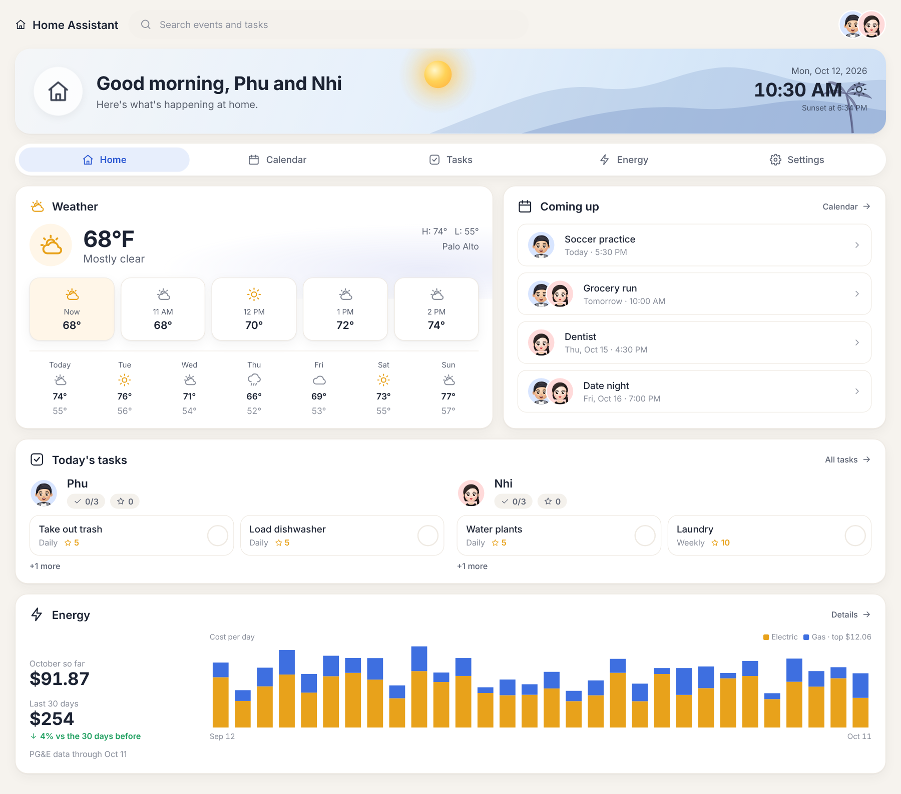

*Screenshots use sample events, tasks, weather and energy data.*

## Features

### Home
A simple top panel with the time, the date and the weather now. Its sky changes color through the day (a warm morning, bright midday, a sunset glow, then night) and the sun moves across it from the city's real sunrise to sunset; the moon and stars come out after dark. The weather moves in the sky too: clouds drift by, rain or snow falls, mist rolls on foggy days and a storm flickers now and then (held still if the device asks for reduced motion). Below it, one glance per person shows how many of their chores are left, plus what in the kitchen to use soon. Then comes Today (today's events and everyone's chores, with a tick to mark each done), Coming up, the forecast for the next hours and 7 days, and a short energy summary. Money owed never shows on Home.

| Day | Night (auto dark theme) |
| --- | --- |
|  | 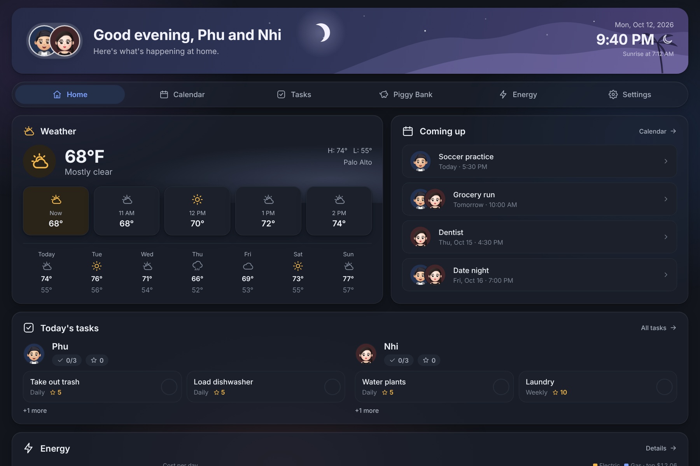 |

### Calendar
List, Week (a time grid) and Month views. Phones open on List and bigger screens on Week. Each event shows who it's for, its start time and its title. The + button adds an event, tapping an event edits or deletes it, and tapping an empty slot in Week view adds one at that hour. Turn on **Important** in an event's sheet to mark it with a red dot everywhere it shows up. Add a **Note** for details only the person who taps it should see, like a gate code: lists show a small note icon, the words appear in a bubble when someone taps the icon, and the recap email leaves them out. The **Chores** toggle adds each day's chores to the calendar.

**Itinerary** is a fourth view for plans like a trip or a day out. It shows the month; tap a day to see that day's activities in time order, and add, edit or delete them there (the + button adds one too). Each activity has a start and end time, where it is (tap to open it in Google Maps), notes, contacts as free text (phone numbers in it are tap to call) and up to six pictures of where to go (tap to see one full screen). The whole household shares the itinerary. Pictures are shrunk on the device and each is stored as its own document beside the household's, so they don't fill up the one shared document everything else lives in.

Events earn stars like chores (5 unless you pick another amount in the event's sheet). Tick an event off on Home or with **Mark done** in its sheet once it has happened. An event for both of you, or for anyone, gives each of you the stars.

| Week | Month |
| --- | --- |
| 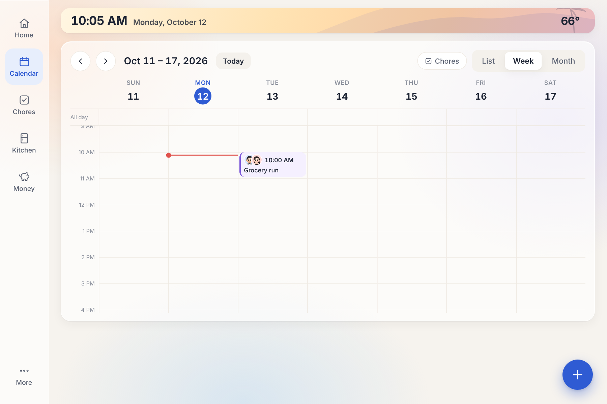 | 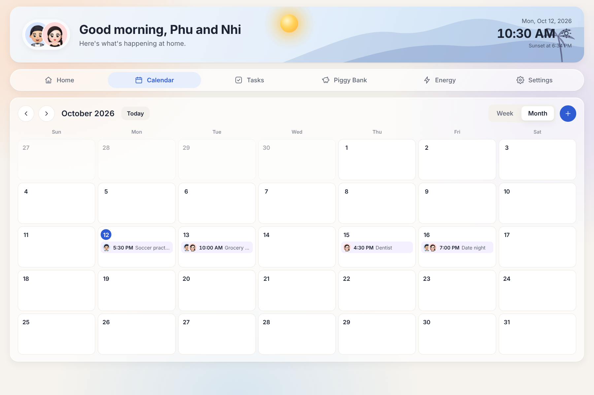 |

### Chores
Who's earned the most stars this week, this month or all time sits at the top, then a card for each person with their chores and how many are done. Chores repeat daily, weekly or once, and daily and weekly chores reset on their own. Tap a chore to edit who it's for, how often it repeats and how many stars it's worth, or mark it **Important** for a red dot. Chores take a hidden **Note** the same way events do. Below the cards, a chart shows stars by day once there are a few active days, and Recent lists what was ticked off. Unticking something takes its stars back.

| Chores | Editing a chore |
| --- | --- |
| 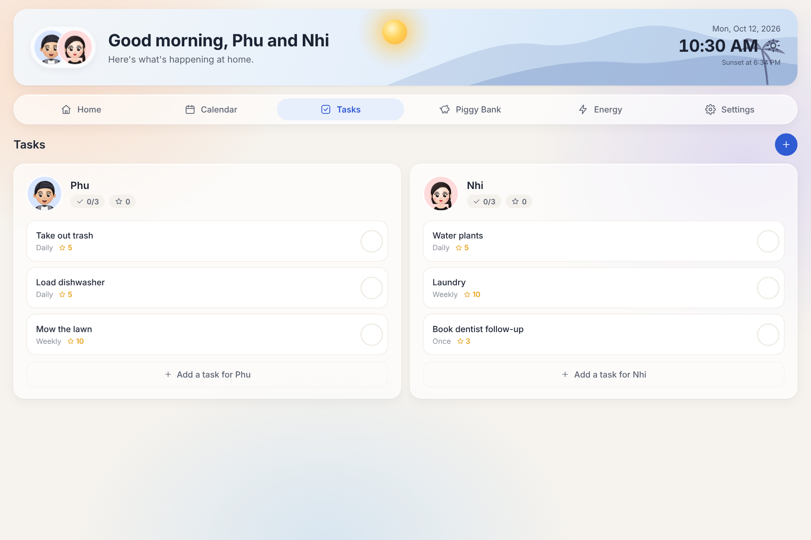 | 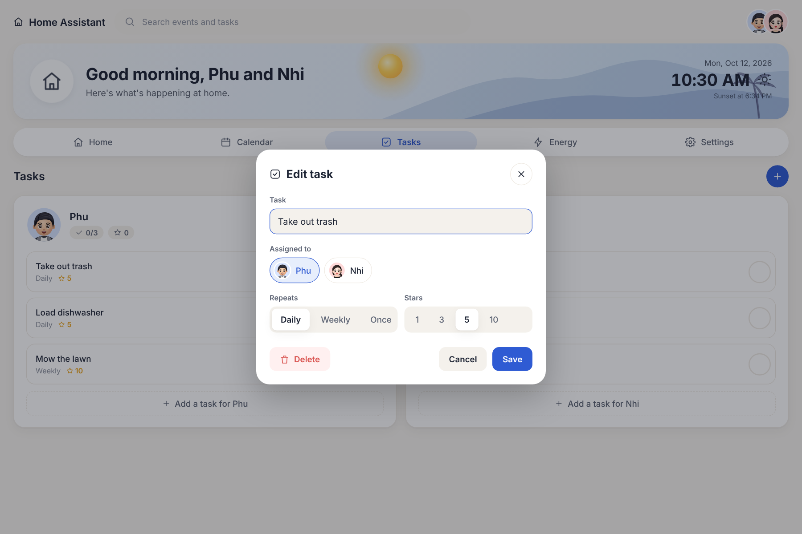 |

### Kitchen
What's in the fridge in one list, sorted so whatever to use soonest is on top, with chips to filter by fruit and veg, dairy and eggs, meat and fish, leftovers, drinks and other. Each item has a count and a suggested use-by date. The − button uses one up, with Undo in case of a mis-tap. **Scan a receipt** (under the + button) reads a photo of a grocery receipt on the device (with [Tesseract.js](https://tesseract.projectnaptha.com/)), lists the items it found with a guessed kind, and adds the ones you keep ticked.

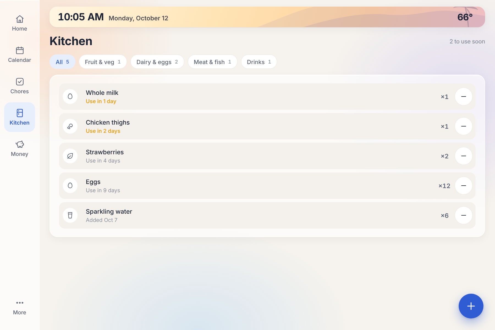

### Money
Shared expenses, one month at a time (the 1st through the last day). It opens with who owes whom and a **Settle up** button, then the month's total, a bar showing what each person paid, and the log grouped by day. Past months are listed below. Log the day, what it was, the amount, who paid and a category (Groceries, Dining out, Transport, Bills, Home, Health, Shopping, Fun, Travel or Other; it guesses one from the name). A **By category** card shows what the month went on; expenses logged before categories count as Other. Expenses can be marked as personal so they stay out of the split, or as paid by **Both** (each paid half) so nobody owes anything on them. Turn off **Show who owes whom** in Settings to hide the balance.

**Boxes** keep a trip or a day out together, like *Japan Box*: tap **New box** (or **Open a box** from the + button), give it a name and, if you like, its days. Expenses you add on those days go in it by themselves, or pick a box on any expense. Each box shows its whole total, what each person paid and who owes whom for it alone; its expenses still count in their months as usual, and deleting a box keeps them.

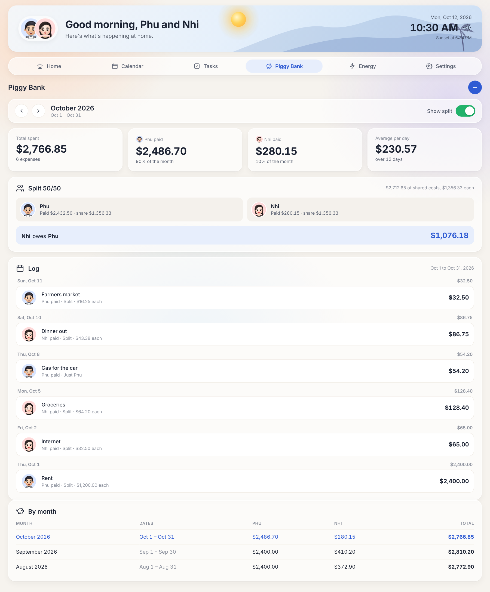

### Energy
PG&E use and cost for the current bill, from the day the billing cycle started through today, with the day count, days left and PG&E's projected bill. Cycles run 29 or 30 days, so the dates come from PG&E's own bills rather than the calendar month. You can also see the last bill, 90 days or 12 months, split into electric and gas, plus a table of past bills. Data syncs every morning (see [PG&E energy sync](#pge-energy-sync)), and the page says plainly when it isn't syncing.

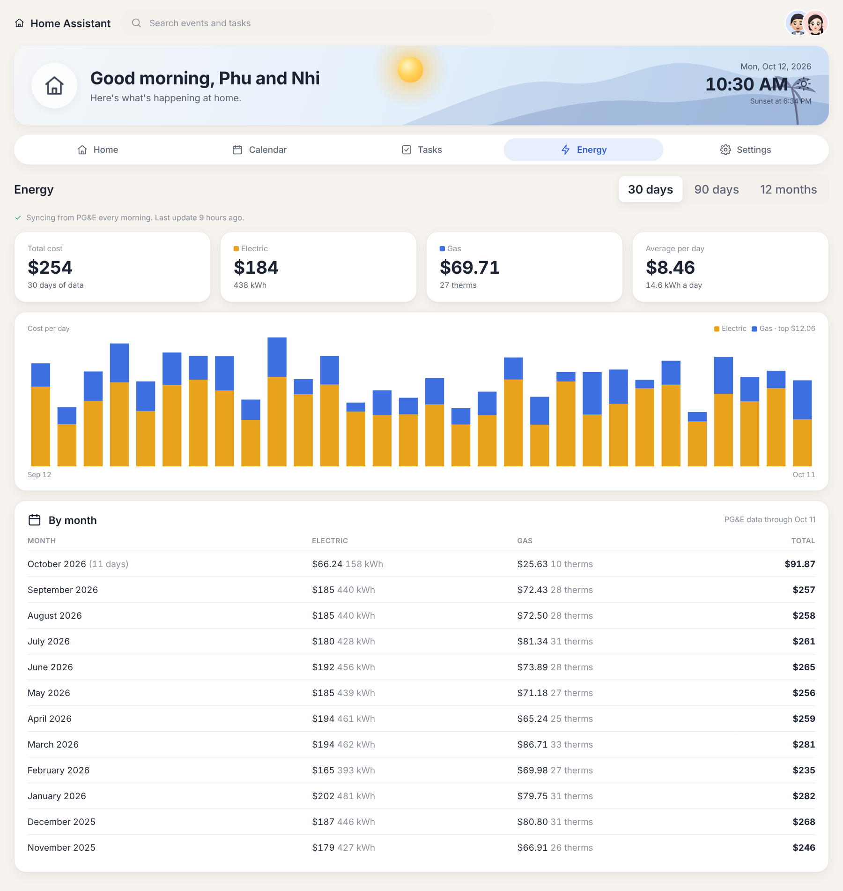

### Health
Fitbit data for each of you: steps today, last night's sleep with deep and REM time, resting heart rate and weight, with 14-day charts and a table of the week. Switch between people at the top. Each person connects their own Fitbit with Google sign-in (see [Fitbit health sync](#fitbit-health-sync)), and their numbers then show on every screen in the household.

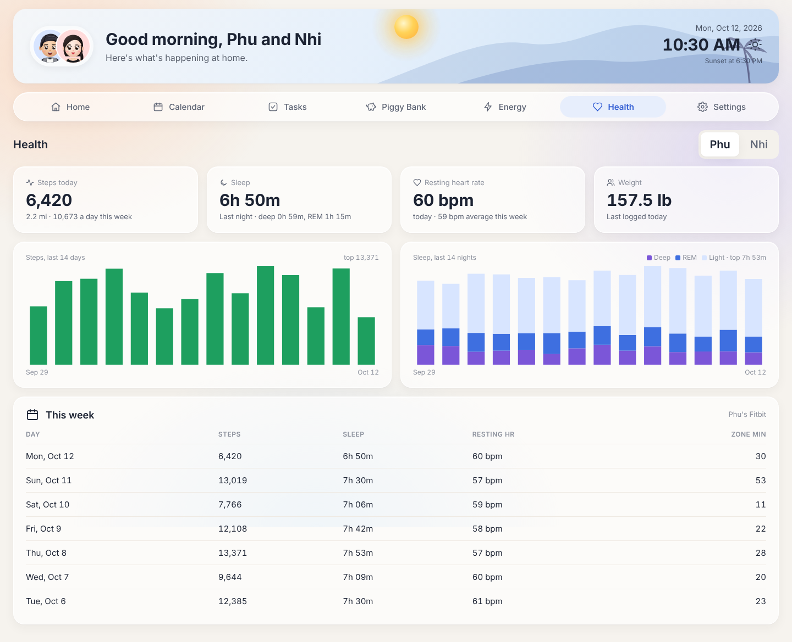

### Friends
A small social network next to your household, on its own tab. Sign in with Google and you get a **friend code**; anyone signed in, from any household, can add you with it, and you're friends once you tap **Accept**. The **Feed** shows your posts and your friends' posts, each with likes and comments, and a post reaches the friends you have when you write it. **Groups** bring together people from any household (family, a trip, a dinner club): make one, tap **Invite** for a 7-day code, and everyone who joins shares the group's feed, **Plans** (with who's going), a **Bucket list** and **Money**, where costs split evenly and **Settle up** records who paid whom back. Nothing from your household (calendar, chores, money, notes) is shared with friends or groups; all of this is stored apart from it, and who can read what is decided by `firestore.rules`. Change the name friends see with **Change name**. Publish the updated `firestore.rules` before using Friends.

### Summary email
A GitHub job emails the household at 7 AM, noon, 5 PM and 9 PM Pacific: the morning one has the day's events, weather, tasks, yesterday's stars, the Money balance and yesterday's energy; noon and 5 PM cover what's left of the day; 9 PM recaps today's stars and shows tomorrow. See [Summary email](#summary-email-setup).

### Settings
Grouped into Display (weather city, °F/°C, light/dark/auto theme, 24-hour clock, keep screen on, show who owes whom), Household (who lives here, who uses this device, sync across devices) and Connections, where PG&E, Fitbit and the summary email each open into their own row with a status and setup steps. Energy, Health and Settings live under **More**.

### Admin
For whoever runs the site, opened from the top of Settings and shown to nobody else. **Monitors** flag trouble: the hourly job not reporting, summary emails failing or not going out, a household near its 1 MiB data limit, old passphrase households still in use, and site settings not filled in. **Stats** count households, the people in them, Google accounts, friendships, groups and posts, list each household's data size, and show the latest summary emails. **Site setup** holds the one-time steps for the summary email, Fitbit, the feedback address and PG&E, which used to sit in Settings.

To turn it on, add the Actions secret `ADMIN_EMAILS` (the Google accounts that may open it, commas between them) and publish the updated `firestore.rules`. The Daily summary email job (`sync/admin_report.py`) writes the numbers and the admin list each hour with its service account; the rules let only those accounts read them, and nobody write them from the app.

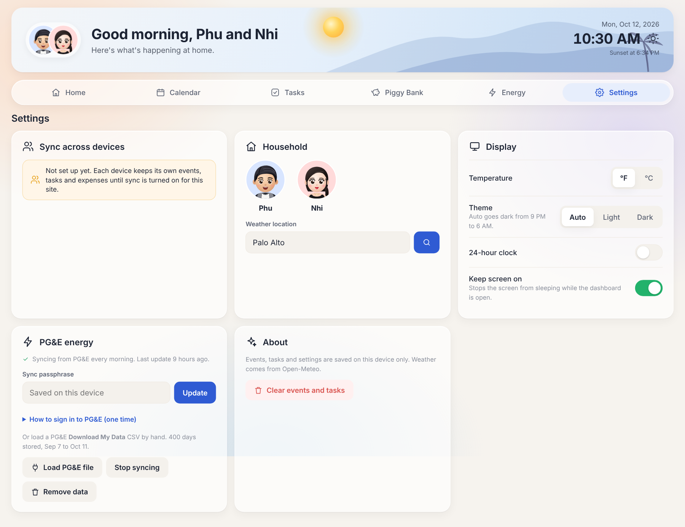

### Works on any screen
The layout adapts from a wide display down to a phone. Every screen gets a see-through tab bar floating at the bottom with Home, Calendar, More and Chores, More in the middle. More opens a half circle with Kitchen, Money, Settings, Energy and Health: tap one, or hold More, slide up, then left or right, and let go on the page you want. One + button adds whatever fits the page you're on. On touch screens you can swipe left or right to move between Home, Calendar and Chores, with the page following your finger. Motion is turned off when the device asks for reduced motion.

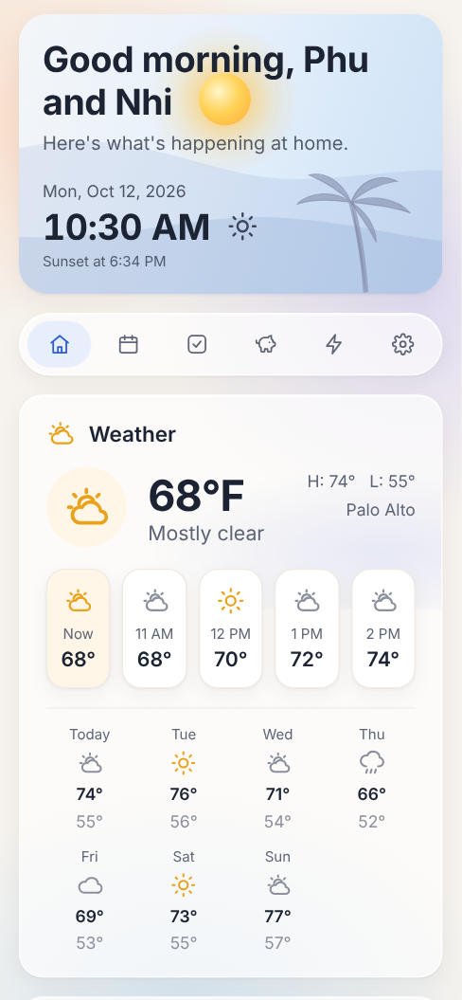

The household's people are set up the first time the app opens (**Who lives here?**) and edited in **Settings › Household**: tap a face to rename someone or change their color, or **Add** for someone new. They sync like everything else, and a household that used the app before this keeps Phu and Nhi with their own avatars from `avatars/`; anyone added later shows their initial. Splitting money, Both (Everyone with three or more people) and thank-yous all work for any number of people. Weather comes from [Open-Meteo](https://open-meteo.com) (free, no API key). **Phone alerts** for a new thank-you or a ticked-off bucket list item come through the free [ntfy](https://ntfy.sh) app: on your phone, pick yourself under **Who uses this device**, tap **Turn on** under Alerts, and subscribe to the channel it shows in ntfy. The channel name is random and only shared within the household, and an alert only says who did what, never what a note says. Display settings are saved in the browser on each device; events, chores, kitchen items and expenses are shared across devices once [sync](#sync-across-devices) is on.

## Set up on your device

1. Open the live site in your browser.
2. Install it as an app so it opens full screen:
   - **Chrome or Edge** (Windows, Mac, Android, ChromeOS): click the install icon in the address bar, or open the browser menu and choose **Install** (Edge: **Apps › Install this site as an app**).
   - **Safari on iPhone or iPad**: tap **Share › Add to Home Screen**.
   - **Safari on Mac**: choose **File › Add to Dock**.
3. In **Settings** inside the dashboard, set the weather city and turn on **Keep screen on**.
4. Optional, for an always-on screen, stop the device itself from sleeping while it's plugged in:
   - **Windows**: Settings › System › Power & battery › set the screen to never turn off when plugged in, and add the app to Startup apps.
   - **iPad**: Settings › Display & Brightness › Auto-Lock › Never.
   - **Android**: Settings › Display › Screen timeout, or Developer options › Stay awake.
   - **Mac**: System Settings › Lock Screen › turn the display off: Never (when on power adapter).

The app keeps working offline, and weather resumes when the connection is back. Events and tasks are stored per device, so each screen keeps its own list.

## PG&E energy sync

The dashboard never signs in to PG&E itself. The Pages workflow does it every morning (about 7 AM Pacific): `sync/pge_sync.py` signs in with the [opower](https://github.com/tronikos/opower) library, reads daily usage and cost for the electric and gas meters, and publishes `data/energy.enc.json` with the site. That file is encrypted (PBKDF2 + AES-GCM) with a passphrase you choose, so the public site only shows scrambled data. Each device unlocks it with the same passphrase.

Your PG&E username and password live only in GitHub's encrypted Actions secrets. They are not in the code, the site or the browser.

One-time setup:

1. In the repo, open **Settings > Secrets and variables > Actions** and add these secrets:
   - `PGE_USERNAME` and `PGE_PASSWORD`: your PG&E sign-in.
   - `ENERGY_PASSPHRASE`: any phrase you make up.
2. PG&E sends a code by email or text the first time a new device signs in. Run this once on your computer, enter the code, and save the line it prints as the `PGE_LOGIN_DATA` secret:
   ```sh
   pip install -r sync/requirements.txt
   python3 sync/pge_pair.py
   ```
   If PG&E later asks for a code again, the dashboard shows "Not syncing". Run the script again and update the secret.
3. In the **Actions** tab, run **Deploy to GitHub Pages** once (**Run workflow**).
4. On each device running the dashboard, open **Settings > PG&E energy**, type the same passphrase and tap **Connect**.

You can also load a PG&E **Download My Data** CSV in the same Settings card instead.

## Fitbit health sync

Fitbit data comes from the [Google Health API](https://developers.google.com/health), read right in the browser. On the Health tab each person taps **Connect** and signs in with the Google account their Fitbit uses. Google gives the page a read-only pass that lasts about an hour and stays in that browser tab; it's never saved. The page reads the last 30 days, and the daily numbers are shared with the household through [sync](#sync-across-devices), encrypted like everything else, so the fridge screen shows everyone's stats without anyone signing in there. Tap **Update** for the latest; while the pass is still good it refreshes by itself.

One-time setup:

1. In the Google Cloud project, enable the **Google Health API**.
2. Under **Google Auth Platform**: fill in **Branding**, set **Audience** to External and add each person's Google account as a test user, and under **Data Access** add the `googlehealth.activity_and_fitness.readonly`, `googlehealth.sleep.readonly` and `googlehealth.health_metrics_and_measurements.readonly` scopes.
3. Under **Clients**, create a **Web application** client with `https://phuvu0107.github.io` as an authorized JavaScript origin. Save its client ID as the Actions secret `GOOGLE_HEALTH_CLIENT_ID` and run **Deploy to GitHub Pages**. The deploy writes it into the published `health-config.js`; the repo copy stays empty.

While the Google app is in Testing, only the test users from step 2 can connect.

## Send feedback

The More half circle has a **Feedback** button that opens a prefilled email (with the page, screen size and app version). To set where it goes, save the address as the Actions secret `FEEDBACK_EMAIL` and run **Deploy to GitHub Pages**. The deploy writes it into the published `feedback-config.js`; the repo copy stays empty, and without the secret the email opens with the To line blank.

## Sync across devices

Events, tasks, stars, expenses and Fitbit numbers can be shared by every device in the house through a free [Firebase](https://firebase.google.com) Firestore database. Everyone signs in with their Google account. The database's rules (`firestore.rules`) let only the people in a household read or change its data, and signing in again on any device, even a new phone, finds the household.

One-time setup:
1. Create a Firebase project, then add a Firestore database in production mode.
2. In **Firestore Database › Rules**, paste the contents of [`firestore.rules`](firestore.rules) and **Publish**.
3. In **Authentication › Sign-in method**, enable **Google**. In **Authentication › Settings › Authorized domains**, add your site's domain (for example `phuvu0107.github.io`).
4. Register a web app in Project settings. Copy its `firebaseConfig` block into a GitHub Actions secret named `FIREBASE_CONFIG` (repo **Settings › Secrets and variables › Actions**), then run **Deploy to GitHub Pages**. The deploy writes it into the published `sync-config.js`, so it never lives in the repo. In Google Cloud's **APIs & Services › Credentials**, restrict that browser key to your site's address.
5. Whenever the app opens on a device that isn't in a household yet, a **Join your household** panel pops up (tap **Not now** to skip until next time; the same button is in **Settings › Sync across devices**). On the first device, sign in with Google and tap **Start a household**: it starts with what's on that screen. Then make an invite code in **Settings › Sync across devices**. On every other device, sign in and type the code under **Join with a code**. Codes work for 7 days. Joining replaces that device's events, tasks and expenses with the shared ones.
6. One person can be in several households (say, home and a parent's place). In **Settings › Sync across devices**, tap **Join or start another household** to type another invite code or start a new, empty one. Each screen shows one household at a time: the household's name shows on Home, and **Switch** in Settings moves the screen to another one. Nothing is lost by switching, and a new device opens the household its owner used last. Rename a household in the same place.

**Households from before sign-in** used a passphrase instead: their data is encrypted in the browser with it, and the record's name is a hash of it. They keep working (the rules above still allow them). To move one to sign-in, sign in on one screen that's synced and tap **Settings › Move this household to sign-in**. Everything moves over, and the old encrypted copy is left as it was. Every other screen then shows **Your household moved**; after a Google sign-in there, it carries on with the same data. Deploy first and give always-on screens ten minutes to reload before moving, since a screen still on an older version doesn't know about the move.

Changes show up on the other screens within a second or two. Edits made offline are kept and sync when the connection comes back, and two people editing at once both keep their changes. Open screens reload themselves within about ten minutes of a new deploy (each deploy writes `version.txt`), and a screen still on an older version passes along any data it doesn't understand instead of deleting it. If the stars for a ticked chore or event ever go missing, the app rebuilds them from the tick.

## Summary email setup

Each household turns its own email on in **Settings › Connections › Summary email**: flip **Email this household** on and list who gets it (up to 10 addresses). It goes out at 7:30 AM, noon, 5 PM and 9 PM on the clock of the screen that saved it, with the weather for that screen's location. Turning it off or changing the list takes effect from the next email. The setting lives on the household's record (`homes/{id}.email`), and each email is marked there once sent (`emailSent`).

`.github/workflows/daily-email.yml` runs `sync/daily_email.py` every hour. It signs in as a service account, finds every household with the email on, and sends each one's email when it comes due. Whoever runs the site adds these Actions secrets once:

| Secret | What it is |
| --- | --- |
| `FIREBASE_SERVICE_ACCOUNT` | A key that can read the households: Firebase console › **Project settings › Service accounts › Generate new private key**, and paste the whole file |
| `EMAIL_SMTP_USER` | The Gmail address that sends the email |
| `EMAIL_SMTP_PASSWORD` | An [app password](https://myaccount.google.com/apppasswords) for that account |
| `HOME_ID` | Optional: the household that gets the PG&E energy line (with `ENERGY_PASSPHRASE`). Until that household turns the email on in Settings, it keeps getting it at `EMAIL_TO` |

Each email opens with the weather (tomorrow's for the 9 PM recap): high and low with the hour each one hits, sunrise, sunset and the chance of rain, and is flagged high importance. To send one right away, run **Daily summary email** from the Actions tab with the household's id (shown under the email setting; blank means `HOME_ID`).

GitHub can start scheduled runs hours late, so the workflow starts every hour and each run keeps sending emails as they come due for 5½ hours. Scheduled runs go one at a time, and the `emailSent` mark keeps each email from going out twice. An email more than an hour past its time is skipped.

## Deploying

Every push to `main` deploys through `.github/workflows/pages.yml`, and it also runs every morning to refresh the PG&E data. One-time setup: in the repo go to **Settings > Pages** and set **Source** to **GitHub Actions**.

## Running locally

```sh
python3 -m http.server 8000
# open http://localhost:8000
```

## Files

- `index.html` – page shell (top panel, tabs, + button)
- `styles.css` – design tokens, light and dark themes, layout and motion
- `app.js` – state, weather, views and actions
- `icons.js` – inline SVG icon set
- `receipt.js` – fridge kinds and the receipt reader
- `sync.js`, `sync-config.js`, `firebase.js` – household sync (Firebase Firestore)
- `account.js`, `firestore.rules` – Google sign-in, invite codes, and who may read each household (rules tested in `tests/rules.emulator.mjs`)
- `admin.js` – the Admin page's data and checks (tested in `tests/admin.test.mjs`; the numbers come from `sync/admin_report.py`)
- `social.js` – friends, the feed and groups (rules tested in `tests/social.emulator.mjs`, helpers in `tests/social.test.mjs`)
- `photos.js` – itinerary and bucket list check-in pictures: shrinking, the copy kept on each device, and syncing them (tested in `tests/photos.test.mjs`)
- `people.js` – the household's people and who owes whom (tested in `tests/people.test.mjs`)
- `avatars/` – Phu's and Nhi's avatars
- `sw.js`, `manifest.webmanifest`, `icons/` – installable PWA and offline cache
- `health.js`, `health-config.js` – Fitbit data through Google sign-in and the Google Health API
- `sync/` – the daily PG&E sync, the one-time sign-in script, the encryption helper, the deploy step that writes the Firebase config, and the summary email
- `docs/screenshots/` – the README screenshots (sample data)
